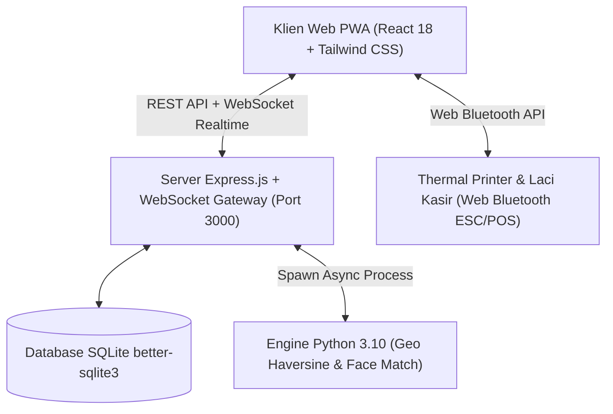
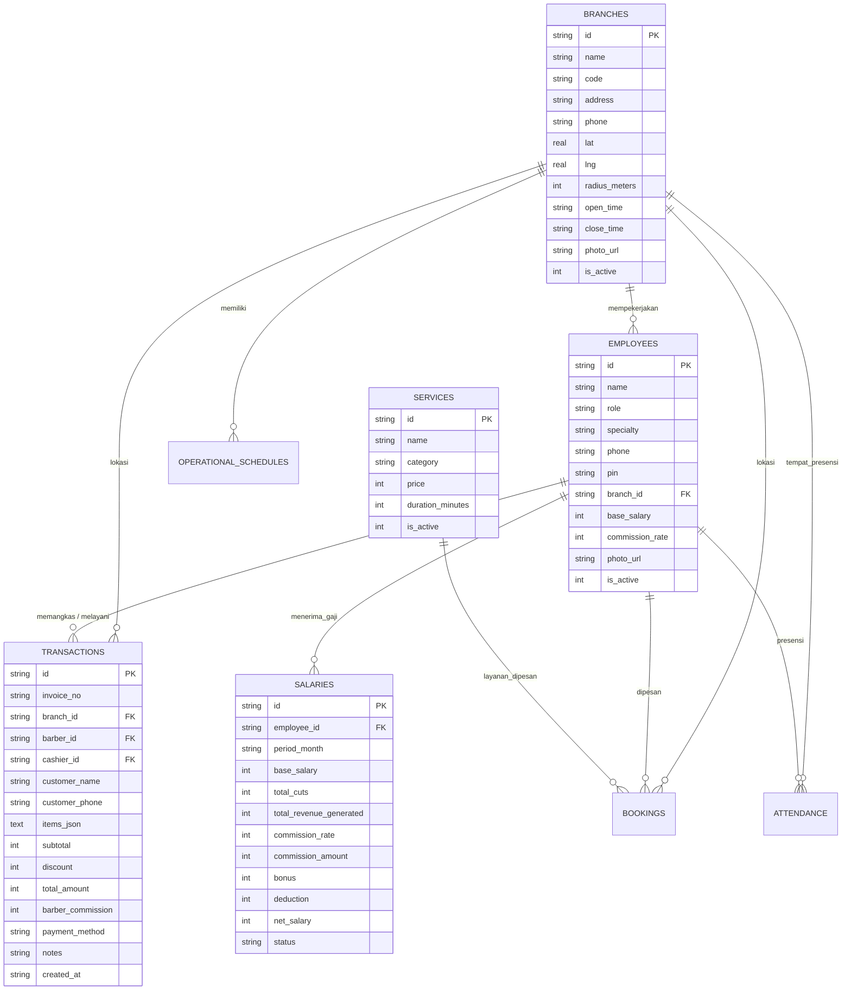

# DOKUMEN ARSITEKTUR, TATA LETAK MENU & SPESIFIKASI SISTEM (PRD / RRD)
## Barbershop Cenderawasih Management System (Nabire, Papua Tengah)
**Versi:** 2.6 (Tahun Operasional 2026) · **Status:** Produksi / Stabil

---

## 1. Ringkasan Eksekutif & Arsitektur Utama

Sistem Manajemen Barbershop Cenderawasih adalah platform web progresif (PWA) terintegrasi berbasis client-server real-time yang dirancang khusus untuk memfasilitasi operasional dua cabang barbershop di Nabire, Papua Tengah:
* **Cabang Pusat (`CW-01`):** Jl. Dr. Sam Ratulangi, Oyehe, Nabire (Jam: 10.00 – 21.30 WIT).
* **Cabang Kedua (`CW-02`):** Jl. Yos Sudarso, Oyehe, Nabire (Jam: 10.00 – 22.00 WIT).

---

## 2. Struktur Role & Hak Akses (Multi-Role RBAC)

Sistem membedakan alur pengguna ke dalam 4 (empat) peran utama:
1. **Pelanggan Publik (Tanpa Login):** Mengakses booking online, daftar harga layanan, promo, lokasi cabang di Google Maps, dan profil barber.
2. **Kasir (PIN Kasir):** Mengakses Point of Sale (POS) Grid tablet, kontrol laci kasir otomatis, koneksi Bluetooth printer thermal, riwayat transaksi, dan dashboard kasir harian.
3. **Karyawan / Barber Capster (PIN Barber):** Mengakses presensi 3 lapis (Wajah + GPS + Jam Kerja), dashboard performa pribadi, hitungan komisi real-time, dan skema gaji 2026.
4. **Owner / Pemilik (PIN 1111):** Akses kontrol penuh (Full CRUD cabang, karyawan, layanan, jadwal operasional, rekap gaji, unduh laporan XLSX/PDF, dan backup database).

---

## 3. Peta Navigasi & Struktur Menu Aplikasi

```mermaid
graph TD
    Root["Aplikasi Barbershop Cenderawasih"]
    
    Root --> PublicNav["1. Navigasi Halaman Publik"]
    Root --> CashierNav["2. Portal Kasir (POS & Transaksi)"]
    Root --> EmployeeNav["3. Portal Karyawan (Barber)"]
    Root --> OwnerNav["4. Portal Owner (Manajemen & Keuangan)"]
    Root --> AttendanceNav["5. Portal Presensi Mandiri (Non-Owner)"]
    
    PublicNav --> HomeSec["Beranda & Video Showcase"]
    PublicNav --> BarberSec["Barber Kami (Capster)"]
    PublicNav --> ServiceSec["Layanan & Harga (Card/List)"]
    PublicNav --> PromoSec["Promo & Info Cabang"]
    PublicNav --> BranchSec["Lokasi & Cabang (Peta & Rute)"]
    PublicNav --> AboutSec["Tentang Kami (Profil Lengkap)"]
    PublicNav --> FloatingBtns["Floating: Tema & Keranjang Online"]
    
    CashierNav --> POSGrid["POS Kasir (Grid Tablet Mode)"]
    CashierNav --> TrxHistory["Riwayat Transaksi (Reprint & Void)"]
    CashierNav --> DailyDash["Dashboard Kasir Transaksi Harian"]
    CashierNav --> BTPrinter["Pengaturan Printer & Laci Kasir"]
    CashierNav --> Salary2026M["Modal Skema Gaji 2026"]
    
    EmployeeNav --> EmpSalaryBanner["Banner Skema Gaji 2026"]
    EmployeeNav --> EmpKPICards["KPI Harian & Bulanan Capster"]
    EmployeeNav --> EmpAttendance["Presensi 3 Lapis (Python Face & GPS)"]
    EmployeeNav --> EmpTrxHistory["Histori Pangkas & Komisi Barber"]
    
    OwnerNav --> OwnFinance["Keuangan & Analytics Charts"]
    OwnerNav --> OwnExcel["Unduh Excel XLSX, PDF & Auto Backup"]
    OwnerNav --> OwnBranch["Manajemen Cabang & Foto Profil"]
    OwnerNav --> OwnStaff["Manajemen Karyawan & PIN"]
    OwnerNav --> OwnSalary["Manajemen Gaji & Komisi 2026"]
    OwnerNav --> OwnSchedule["Jadwal Operasional Cabang"]
    OwnerNav --> OwnAttendanceLog["Monitoring Presensi Seluruh Cabang"]
    OwnerNav --> OwnContent["Manajemen Konten & Banner Video"]
```

---

## 4. Tata Letak & Penempatan Halaman Menu Secara Mendalam

### 4.1 Halaman Publik (Customer Portal)
* **Navbar Utama:**
  * Kiri: Logo Resmi Barbershop Cenderawasih & Nama Brand.
  * Tengah (Tautan Cepat):
    1. **Beranda** (Hero Section & Video Promo)
    2. **Barber Kami** (Ditempatkan di urutan kedua setelah Beranda, dilengkapi efek RGB Glow Shadow)
    3. **Layanan & Harga** (Pilihan kategori HAIRCUT, PERMING, COLORING, STYLING)
    4. **Promo & Berita** (Postingan diskon & info cabang)
    5. **Lokasi & Cabang** (Banner foto cabang Sam Ratulangi `CW-01` & Yos Sudarso `CW-02` + Rute Google Maps)
    6. **Tentang Kami** (Ditempatkan di urutan akhir navigasi publik)
  * Kanan: Tombol **Cek Status Booking** dan **Masuk Karyawan/Staf**.
* **Tombol Aksi Mengapung (Floating Actions):**
  * **Floating Theme Switcher:** Tombol apung di pojok kanan untuk beralih mode Terang / Gelap tanpa memadati navbar.
  * **Floating Keranjang Pesanan Online:** Tombol apung dengan badge keranjang belanja untuk memudahkan pemesanan layanan online.
* **Footer Minimalis:**
  * Menampilkan hak cipta, alamat cabang Nabire, tautan sosial media resmi, dan logo interaktif sebagai shortcut tersembunyi login staf.

---

### 4.2 Portal Kasir (Point of Sale Tablet Grid)
Dirancang khusus menyerupai antarmuka tablet kasir fisik:
* **Sub-Tab Switcher Atas:**
  * `[POS Kasir (Grid)]` · `[Riwayat Transaksi]` · `[Dashboard Harian]` · `[Printer & Laci]` · `[Skema Gaji 2026]`
* **Action Bar Atas POS:**
  1. **Laci Kasir (Merah):** Membuka laci kasir (Kick Drawer) + suara bel kasir.
  2. **Tahan transaksi (Kuning Emas):** Menahan transaksi aktif ke dalam antrean order dengan counter badge.
  3. **Stok Persediaan (Kuning):** Cek stok sisa produk retail (pomade, hair powder, tonic) dan tambah ke keranjang.
  4. **Pelanggan (Hijau):** Input nama dan nomor WhatsApp pelanggan walk-in.
  5. **Hapus (Oranye/Merah):** Mengosongkan keranjang aktif.
  6. **Masukan Barcode & Search:** Input pencarian cepat layanan atau barcode produk.
* **Kolom Kiri (Keranjang POS):**
  * Tampilan Kosong: Menampilkan tulisan *"Tidak ada data"*.
  * Tampilan Terisi: Kartu layanan, nama barber, kuantiti stepper (`-` / `+`), dan harga.
  * Bawah: Baris `Total: RpX,00` dan tombol merah besar **`Pembayaran`**.
* **Kolom Kanan (Barber & Layanan):**
  * **Tab Barber:** `HAIKAL`, `UDIN`, `ACEL`, `ASWAR`, `PRODAK`, `NOEL`, `ATTA`. Tab aktif memiliki outline border oranye tegas.
  * **Tab `PRODAK`:** Menampilkan grid retail pomade, powder, dan vitamin rambut beserta stok sisa.
  * **Tab Barber:** Menampilkan 16 grid layanan:
    1. *HARCUT PREMIUM* (Rp150.000)
    2. *HAIRCUT REGULER* (Rp85.000)
    3. *HAIRCUT SCHOOL* (Rp70.000)
    4. *HAIRCUT MEMBER* (Rp50.000)
    5. *HAIRCUT+SHAVING* (Rp120.000)
    6. *HAIR PERMING PENDEK* (Rp350.000)
    7. *SEMIR HITAM* (Rp100.000)
    8. *HIGHLIGHT WARNA* (Rp450.000)
    9. *HIGHLIGHT BLEACHING* (Rp350.000)
    10. *FULL ATAS COLORING* (Rp450.000)
    11. *BLACING* (Rp350.000)
    12. *HIGHLIGHT PANJANG* (Rp550.000)
    13. *BUZCUT FULL* (Rp400.000)
    14. *BUZCUT ALOY* (Rp450.000)
    15. *FULL COLORING* (Rp550.000)
    16. *Tambahan Warna* (Rp350.000)
* **Modal Pembayaran:**
  * Pilihan metode: Tunai, QRIS Dinamis (EMVCo), Transfer Bank, Debit.
  * Pembayaran Tunai: Tombol nominal instan (*Uang Pas, 50k, 100k, 150k, 200k, 300k, 500k*) dan perhitungan kembalian otomatis.
  * Checkbox: *Buka laci otomatis* & *Cetak struk otomatis*.

---

### 4.3 Sub-Tab Riwayat Transaksi Kasir
* **Filter Multi-Kriteria:** Rentang waktu (Hari Ini, Kemarin, 7 Hari, Bulan Ini, Semua), Capster Barber, Metode Pembayaran, dan Pencarian teks.
* **Metrik Ringkasan:** Total nominal transaksi terfilter dan jumlah struk selesai.
* **Aksi per Transaksi:** Cetak Ulang Struk (Bluetooth Thermal / Browser), Buka Struk Digital, dan Batalkan/Void Transaksi.

---

### 4.4 Sub-Tab Dashboard Kasir Harian
* **Kartu KPI Harian:** Total Omset, Penjualan Tunai (Fisik Laci), Non-Tunai (QRIS & Transfer Bank), dan Total Komisi Barber.
* **Buku Rekonsiliasi Kas Laci (Cash Drawer Float):**
  * Input Modal Awal Kasir (Floating Cash pagi hari, disimpan di `localStorage`).
  * Perhitungan Uang Fisik Laci: `Modal Awal + Penjualan Tunai`.
  * Tombol manual buka laci kasir untuk audit fisik kas.
* **Leaderboard Capster Hari Ini:** Menampilkan ranking barber berdasarkan jumlah kepala yang dipangkas hari ini, omset dihasilkan, dan hak komisi harian.

---

### 4.5 Sub-Tab Pengaturan Thermal Printer & Laci Kasir
* **Koneksi Web Bluetooth API:** Tombol Hubungkan / Putuskan printer thermal 58mm & 80mm.
* **Status Koneksi:** Indikator visual hijau/abu-abu dan nama printer Bluetooth yang terpasang.
* **Alat Pengujian:** Tombol uji coba kick drawer Pin 2 dan tombol cetak struk uji coba.
* **Opsi Otomasi:** Sakelar otomatis buka laci saat transaksi dan otomatis cetak struk setelah bayar.

---

### 4.6 Sistem Gaji Barber 2026 (Komisi & Bonus Target Bulanan)
Diimplementasikan pada `BarberSalarySchemeModal.tsx` dan terintegrasi pada portal Kasir, Karyawan, serta Owner:
* **Gaji Pokok:** **Rp 2.000.000 / bulan** untuk seluruh barber.
* **Struktur Komisi Haircut:**
  * *Haircut Premium (Rp150.000):* **30% = Rp 45.000**
  * *Haircut Reguler (Rp85.000):* **25% = Rp 21.250**
  * *Haircut Basic/School (Rp70.000):* **20% = Rp 14.000**
  * Layanan pewarnaan/perming/produk: rate standar 25% – 40%.
* **Jenjang Karier & Bonus Target Bulanan:**
  * **100 Pelanggan:** Bonus **Rp 200.000**
  * **150 Pelanggan (Barber Junior):** Bonus **Rp 500.000** $\rightarrow$ Total: **Rp 5.687.500**
  * **200 Pelanggan (Barber Senior):** Bonus **Rp 1.000.000** $\rightarrow$ Total: **Rp 7.250.000**
  * **300 Pelanggan (Legend Barber):** Bonus **Rp 2.500.000** $\rightarrow$ Total: **Rp 10.875.000**
* Dilengkapi kalkulator simulasi gaji interaktif berdasarkan slider jumlah pelanggan bulanan.

---

### 4.7 Portal Owner (Manajemen & Pemilik)
* **Tab 1: Keuangan & Analytics:** Grafik visual pendapatan, perbandingan omset antar cabang, distribusi metode pembayaran, dan riwayat laba kotor.
* **Tab 2: Rekap Excel, PDF & Auto Backup:**
  * Ekspor berkas `.xlsx` komprehensif multi-sheet: *Ringkasan Dashboard, Rekap Finansial, Biaya Operasional, Kinerja Barber, Matriks Presensi Karyawan*.
  * Unduh Laporan PDF berstandar cetak.
  * Fitur pencadangan otomatis (Auto Backup) database SQLite ke direktori `data/backups/`.
* **Tab 3: Manajemen Cabang:**
  * Pengaturan nama cabang, kode cabang, alamat, nomor telepon, koordinat GPS, radius geofence, dan jam operasional.
  * **Foto Profil Cabang:** Pengaturan foto profil storefront dan interior studio dengan pilihan preset atau tautan kustom.
* **Tab 4: Manajemen Karyawan:** Tambah, edit, nonaktifkan staf, ganti PIN, tentukan peran (kasir/karyawan), dan unggah foto profil wajah.
* **Tab 5: Manajemen Gaji & Komisi:** Sinkronisasi komisi otomatis dari transaksi riil, penyesuaian bonus/potongan, dan konfirmasi status pembayaran gaji.
* **Tab 6: Jadwal Operasional:** Jam buka-tutup mingguan per cabang, jeda Sholat Jumat (11.45 – 13.00 WIT), dan penugasan jadwal barber.
* **Tab 7: Log Presensi Cabang:** Rekap absensi real-time seluruh cabang, status geofence, persentase kecocokan wajah, dan verifikasi waktu.
* **Tab 8: Konten & Media:** Pengaturan video showcase hero, subtitle banner, dan postingan promosi.

---

### 4.8 Portal Presensi Mandiri (Attendance Portal)
Dikhususkan untuk seluruh staf operasional (Kasir & Karyawan) dengan 3 lapis keamanan:
1. **Verifikasi Lokasi (GPS Haversine):** Memastikan karyawan berada di dalam radius resmi cabang (150 meter).
2. **Verifikasi Wajah (Face Recognition):** Membandingkan foto selfie langsung dengan foto profil karyawan menggunakan Python OpenCV & Cosine Similarity.
3. **Verifikasi Jam Operasional:** Mengecek jam masuk terhadap jadwal buka cabang di database.

---

## 5. Struktur Tabel Database Relasional (SQLite)

---

## 6. Integrasi Perangkat Keras & Protokol Thermal

* **Antarmuka Web Bluetooth:** Menggunakan `navigator.bluetooth` dengan chunking payload 100 bytes untuk kompatibilitas thermal printer Bluetooth BLE (58mm dan 80mm).
* **Perintah Hardware ESC/POS:**
  * *Inisialisasi:* `[0x1b, 0x40]`
  * *Teks Rata Tengah & Bold:* `[0x1b, 0x61, 0x01]`, `[0x1b, 0x45, 0x01]`
  * *Buka Laci (Kick Drawer Pin 2):* `[0x1b, 0x70, 0x00, 0x19, 0xfa]`
  * *Pemotong Kertas:* `[0x1d, 0x56, 0x41, 0x10]`
* **Fallback Perangkat Lunak:** Jendela cetak thermal browser mandiri (`printReceiptViaBrowser`) dan Web Audio API lonceng mekanik laci kasir saat Bluetooth tidak terhubung.
